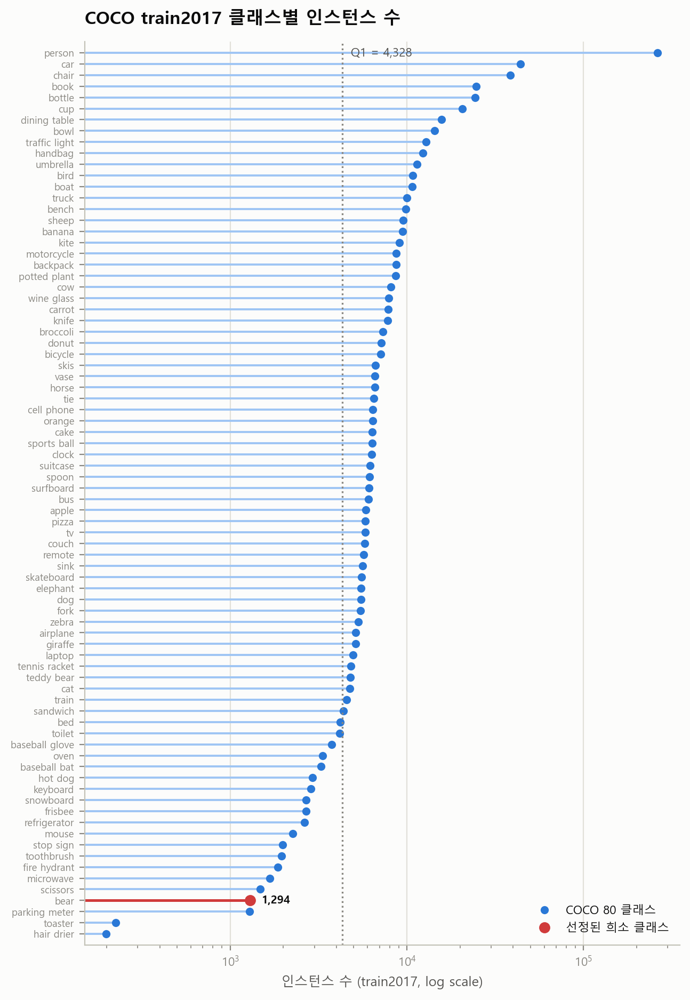
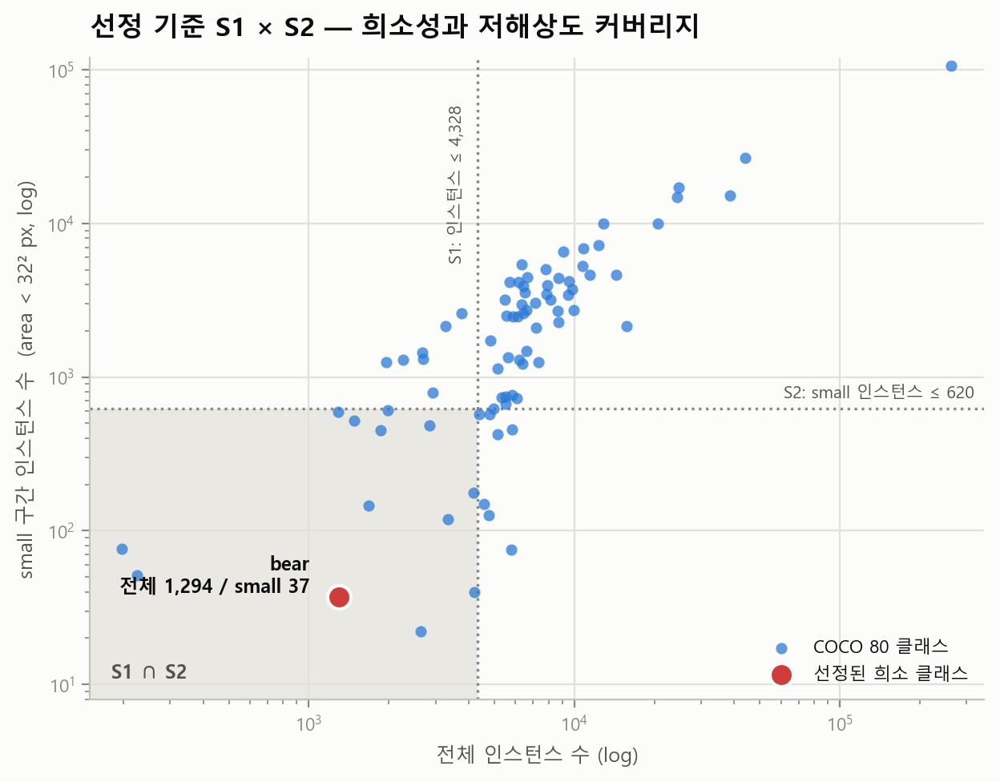
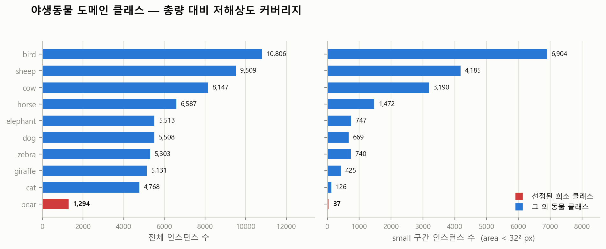

# 1. 사전학습 데이터 분포 분석과 희소 클래스 선정

> 연구 주제: **저화질 영상의 희소 객체 인식 모델 개발**
> 이 문서가 답하는 질문: 사전학습 YOLO는 *어떤* 클래스에 데이터가 부족하며, 그것을
> 무엇으로 판정했는가.

재현 명령

```bash
python scripts/00_download_coco.py            # 어노테이션 다운로드 (241 MB)
python scripts/01_analyze_coco_distribution.py # 전수 집계 + 클래스 선정
python scripts/02_build_real_bear_sets.py      # 실데이터 기준셋 구축
```

---

## 1.1 분석 대상과 근거 데이터

사전학습 YOLO(YOLOv8/v11 계열의 `*.pt` 공개 가중치)는 전부 **COCO 2017 train** 으로
학습된다. 따라서 "사전학습 모델에 부족한 클래스"는 COCO train2017 어노테이션을
전수 집계하면 추정이 아니라 사실로 확정된다.

| 항목 | 값 |
|---|---|
| 근거 파일 | `annotations/instances_train2017.json` (469,785,474 B) |
| 배포 아카이브 | `annotations_trainval2017.zip`, 252,907,541 B |
| SHA-256 | `113a836d90195ee1f884e704da6304dfaaecff1f023f49b6ca93c4aaae470268` |
| 출처 | http://images.cocodataset.org/annotations/annotations_trainval2017.zip |
| 이미지 수 | 118,287 |
| 인스턴스 수 | 860,001 (`iscrowd` 포함) |
| 클래스 수 | 80 |

> 다운로드 주의: `images.cocodataset.org` 는 S3 리다이렉트 때문에 TLS 인증서
> 호스트명이 불일치한다(`CERTIFICATE_VERIFY_FAILED: Hostname mismatch`). 공식 배포
> 경로가 `http` 로도 동일 바이트를 서비스하므로 `http` 로 받고 SHA-256 으로
> 무결성을 검증했다. 인증서 검증을 끄는 방식(`verify_mode=CERT_NONE`)은 쓰지 않았다.

집계 항목은 클래스별 인스턴스 수·이미지 수·점유율·이미지당 인스턴스 수,
COCO 공식 크기 구간(small `area < 32²`, medium `32²~96²`, large `> 96²`)의 비율과
**절대 개수**, 상대 bbox 면적 중앙값, `iscrowd` 비율이다.
전체 표는 [`reports/coco_class_stats.md`](../reports/coco_class_stats.md) /
[`reports/coco_class_stats.csv`](../reports/coco_class_stats.csv).

## 1.2 분포는 얼마나 치우쳐 있는가



로그 축이어야 80 클래스가 한 그림에 들어간다. 선형 축에서는 하위 클래스가
아예 보이지 않는다는 것 자체가 불균형의 크기를 말해 준다.

| 클래스 | 순위 | 인스턴스 | 점유율 | 1위 대비 |
|---|---|---|---|---|
| person | 1 | 262,465 | 30.52 % | 1.0× |
| car | 2 | 43,867 | 5.10 % | 6.0× |
| bear | 77 | 1,294 | 0.150 % | **202.8×** |
| hair drier | 80 | 198 | 0.023 % | 1325.6× |

상위 1개 클래스(`person`)가 전체 인스턴스의 **30.5 %** 를 차지한다. 균등 분포라면
클래스당 1.25 % 여야 하므로 24배 초과다. 반대편 하위 사분위 20개 클래스는
합쳐도 전체의 5 % 미만이다. 사전학습 YOLO의 클래스별 성능 격차는 모델 구조
문제가 아니라 **이 분포가 그대로 반영된 결과**다.

## 1.3 선정 기준 — 3중 조건

"인스턴스 수가 적다"만으로 고르면 이 연구의 절반(저화질)을 놓친다. 세 조건을
동시에 요구했다.

| 기준 | 정의 | 임계값 | 왜 필요한가 |
|---|---|---|---|
| **S1** 절대 희소성 | 인스턴스 수가 80클래스 분포의 하위 사분위 이하 | ≤ 4,328 | 학습 사례 총량 부족 = 생성 증강의 대상 |
| **S2** 저화질 취약 | **small 구간 인스턴스의 절대 개수**가 하위 사분위 이하 | ≤ 620 | 저화질·원거리 영상에서 객체는 작게 나타난다 |
| **S3** 도메인 관련 | 야생동물 활동 영상 / 실외 감시 도메인에 실제 등장 | 정성 | 5/14 공유 자료의 적용 대상과 일치해야 의미가 있다 |

**S2를 비율이 아니라 절대 개수로 정의한 이유.** 검출기가 어떤 클래스를 저해상도에서
찾아낼 수 있는 한계는 그 클래스를 *작게* 본 학습 사례의 수가 결정한다. 비율로
재면 두 방향으로 다 틀린다. `person` 은 small 비율이 0.40 에 불과하지만 절대
small 인스턴스가 105,895개라 저해상도에서 아무 문제가 없다. `hair drier` 는
small 비율이 0.38 로 비슷하지만 절대 개수는 76개다. 같은 비율, 완전히 다른 상황이다.
분모를 없애고 절대 개수로 보는 것이 맞다.



두 기준을 축으로 놓으면 좌하단 음영이 S1 ∩ S2 교집합이다. 여기에 S3(도메인)을
교차시킨 결과, **80개 클래스 중 3중 조건을 모두 만족하는 클래스는 `bear` 하나**였다.

- S1 통과 20개: bed, toilet, baseball glove, oven, baseball bat, hot dog, keyboard, snowboard, frisbee, refrigerator, mouse, stop sign, toothbrush, fire hydrant, microwave, scissors, **bear**, parking meter, toaster, hair drier
- S2 통과 20개: tv, couch, giraffe, teddy bear, cat, train, sandwich, bed, toilet, oven, keyboard, refrigerator, stop sign, fire hydrant, microwave, scissors, **bear**, parking meter, toaster, hair drier
- S1 ∩ S2 ∩ S3 = **{ bear }**

## 1.4 왜 bear 인가 — 도메인 내부 비교



| 클래스 | 전체 인스턴스 | 이미지 | small 인스턴스 | small 비율 | 전체 순위 |
|---|---|---|---|---|---|
| bird | 10,806 | 3,237 | 6,904 | 0.639 | 12 |
| sheep | 9,509 | 1,529 | 4,185 | 0.440 | 16 |
| cow | 8,147 | 1,968 | 3,190 | 0.392 | 22 |
| horse | 6,587 | 2,941 | 1,472 | 0.223 | 31 |
| elephant | 5,513 | 2,143 | 747 | 0.135 | 49 |
| dog | 5,508 | 4,385 | 669 | 0.121 | 50 |
| zebra | 5,303 | 1,916 | 740 | 0.140 | 52 |
| giraffe | 5,131 | 2,546 | 425 | 0.083 | 54 |
| cat | 4,768 | 4,114 | 126 | 0.026 | 58 |
| **bear** | **1,294** | **960** | **37** | **0.029** | **77** |

`bear` 는 COCO 동물 클래스 10개 중 **양쪽 지표 모두 최하위**다. 두 번째로 적은
`cat` 과 비교해도 전체 인스턴스는 3.7배, small 인스턴스는 3.4배 적다.

가장 결정적인 수치는 이것이다.

> **COCO train2017 전체 어노테이션 860,001개 중, "작은 곰"은 37개다 (0.0043 %).**
> 같은 도메인의 `bird` 는 6,904개 — **186.6배**.

즉 사전학습 YOLO는 곰이라는 객체를 **작고 흐릿한 형태로 본 경험이 사실상 없다.**
저화질 감시 영상에서 곰을 놓치는 것은 예측되는 실패가 아니라 **예정된 실패**다.
이 연구가 메우려는 구멍이 정확히 여기다.

부수적으로, `bear` 의 상대 bbox 면적 중앙값은 0.101 로 `person`(0.0069)의 15배다.
COCO의 곰 데이터는 **크고 선명한 근접 촬영에 심하게 편향**되어 있다. 총량이 적은
것보다 이 편향이 더 문제인데, 데이터가 있는 구간(크고 깨끗한 곰)과 실제로 필요한
구간(작고 흐린 곰)이 어긋나 있기 때문이다. 단순히 곰 사진을 더 모으는 것으로는
해결되지 않고, **원하는 스케일·화질 조건을 지정해 데이터를 만들어야** 한다 —
생성 모델을 쓰는 이유가 여기서 나온다.

## 1.5 실데이터 기준셋 구축 결과

생성 데이터가 성능을 올렸는지 판정할 기준이 없으면 데이터셋만 남고 근거가 없다.
COCO 실제 `bear` 이미지를 두 갈래로 확보했다. **둘 다 제출용 생성 데이터셋에
섞지 않는다.**

| 세트 | 출처 | 이미지 | bear 박스 | large / medium / small | 용도 |
|---|---|---|---|---|---|
| `real_val` | val2017 전량 | 49 | 71 | 53 / 13 / **5** | 홀드아웃 평가 전용. 학습 투입 금지 |
| `real_ref` | train2017 상위 400 (image_id 정렬) | 400 | 534 | 412 / 109 / **13** | 사실성 지표(FID/CLIP) 참조, 프롬프트 설계 |

다운로드 성공률 449/449 (100 %). 라벨은 YOLO 포맷(`class cx cy w h`, 정규화,
단일 클래스이므로 index 0)으로 변환해 `data/interim/real_bear/*/labels/` 에 두었다.
출처·라이선스·bbox 통계는 `data/interim/real_bear/manifest.json` 에 전부 기록했다.

여기서 두 번째 문제가 드러난다.

> **COCO val2017의 bear 박스 71개 중 small 은 5개다.**
> 기성 COCO val 로는 저화질·원거리 곰 검출 성능을 *측정할 수조차 없다.*

따라서 2차에서 열화 모델을 만들 때, 그것을 생성 데이터 제작뿐 아니라
**`real_val` 에 동일하게 적용해 실데이터 열화 평가셋(`real_val_lq`)을 만드는 용도로도
쓴다.** 평가 조건을 실제 문제(저화질)와 일치시키기 위한 것이며, 평가셋의 원본
이미지는 어디까지나 사람이 라벨링한 실제 COCO 데이터이므로 생성 데이터로 평가를
자기참조하는 문제는 발생하지 않는다.

## 1.6 라이선스 처리

`real_val` / `real_ref` 이미지 449장의 Flickr 라이선스 분포는 다음과 같다.

| 라이선스 | 장수 |
|---|---|
| Attribution-NonCommercial-NoDerivs | 161 |
| Attribution-NonCommercial-ShareAlike | 107 |
| Attribution | 69 |
| Attribution-NonCommercial | 48 |
| Attribution-NoDerivs | 37 |
| Attribution-ShareAlike | 25 |
| No known copyright restrictions | 2 |

과반이 `NoDerivs` 또는 `NonCommercial` 이다. 그래서 **실제 COCO 이미지는 제출
zip 에 포함하지 않는다.** 레포에는 `manifest.json`(image_id, `coco_url`,
라이선스 id/명/URL)만 커밋하고, `scripts/02_build_real_bear_sets.py` 로 누구나
동일한 세트를 재구성할 수 있게 했다. `.gitignore` 가 `data/raw/`, `data/interim/`,
`data/dataset/` 을 제외한다.

제출 zip 에 들어가는 것은 생성 모델이 만든 이미지와 그 라벨뿐이다. 사용 모델의
가중치 라이선스(예: SDXL-Turbo 의 STAI Non-Commercial Research Community License)는
2차 문서에서 모델별로 명시한다.

## 1.7 1차 결론 및 2차로 넘기는 것

**결정 사항**

1. 타깃 희소 클래스 = **`bear`** (단일 클래스, COCO class id 23 / YOLO index 21).
   80클래스 중 S1·S2·S3 3중 조건을 동시에 만족하는 유일한 클래스.
2. 데이터셋이 채워야 할 구간은 "곰 사진 일반"이 아니라
   **작은 스케일 × 저화질 × 실외 감시 조건의 곰**이다. COCO에 37개뿐인 그 구간.
3. 평가는 `real_val`(원본) 과 `real_val_lq`(동일 열화 적용) 두 조건으로 하고,
   학습에는 생성 데이터만 쓴다.

**2차 작업 항목**

- 열화 모델: 실제 저화질 감시 영상 특성(모션 블러 → 다운스케일 → 센서 노이즈 →
  압축 아티팩트) 순차 적용. 5/21 조사한 디블러링·업스케일링 선행연구를 역방향
  열화 설계의 근거로 연결.
- 생성 파이프라인: text-to-image 로 다양성 확보 + inpainting 으로 **마스크에서
  정확한 bbox 를 직접 얻는** 경로. 후자는 자동 라벨의 기하학적 정확성을 보장한다.
- 자동 라벨링과 품질 게이트: 검출기 확신도, CLIP 유사도, 지각 해시 중복 제거,
  사람 검수 표본.
- 스케일 분포 설계: `real_val` 이 large 편중(53/71)인 반면 생성 데이터는 small 을
  다수로 두어 결핍 구간을 겨냥한다. 목표 분포를 2차에서 수치로 고정.
