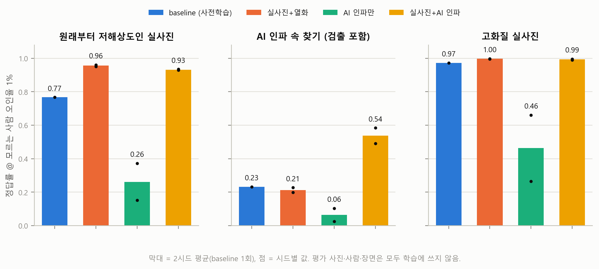

# 7. 8차 — 저화질 CCTV 인파 속 특정인 찾기 (얼굴인식, 10명)

> **주제 (2026-10-01 확정)**: 찾을 사람의 사진을 주면 저화질 CCTV 인파 속에서 그 사람을
> 찾아내는 AI. 사람 1명 = 클래스 1개. 사람이 붐비는 공간을 생성형 모델로 만들고, 그런
> 곳에서의 정확도를 높이는 것이 목표다.
>
> **결론**: 실사진에 **AI로 그려 넣은 인파 데이터 + 배경 군중 하드 네거티브**를 섞어
> 파인튜닝하면, 인파 속 찾기가 사전학습 대비 **0.233 → 0.537(2.3배)**로 오른다. 원래부터
> 저화질인 실사진에서도 0.767 → 0.932로 개선된다. 반면 **AI 인파 데이터만으로 학습하면
> 실사진 인식이 무너진다**(고화질 0.97 → 0.46). 7차에서 본 "순수 합성 데이터는 해롭다"는
> 결과가 얼굴인식에서도 재현된 것이다.

## 7.0 데이터 — LFW + VGGFace2 통합

구현: [scripts/30_build_face_dataset.py](../scripts/30_build_face_dataset.py),
[31_build_face_eval_sets.py](../scripts/31_build_face_eval_sets.py),
[30b_export_identity_classes.py](../scripts/30b_export_identity_classes.py)

사용자가 넣은 `data/dataset/LFW.zip`(lfw-deepfunneled, 5,749명 13,233장, 표준 pairs 포함)과
`VGG_Face2.zip`(원본 train 480명 17.6만 장 + 원본 test 60명 2.1만 장의 부분집합)을 MTCNN으로
160×160 정렬 크롭으로 통일했다. 총 **106,145장, 6,289명**이고 사람마다 전역 ID를 부여했다.
검출 실패 298장은 버렸다. 사진이 20장 미만인 사람은 클래스에서 제외해 602명이
남았다(LFW 5,687명 제외). 제외된 LFW 인원은 1:N 방해 신원과 표준 6,000쌍 검증에만 쓴다.

**원본 해상도를 기록해 "원래부터 저화질인" 평가셋을 만들었다.** VGGFace2는 원본 해상도를
그대로 둔 느슨한 크롭이라, 원본 얼굴 박스가 43px 이하인 사진(하위 12%, 중앙값 36px)이
자연 발생 저해상도 얼굴이 된다. 5차에서 얻은 교훈 — 우리 열화 함수로 흐리게 만든 사진으로
평가하면 개선이 과대평가된다 — 을 그대로 적용한 것이다.

## 7.1 인파 CCTV 장면 생성

구현: [scripts/32_generate_face_cctv_scenes.py](../scripts/32_generate_face_cctv_scenes.py)

SDXL-Turbo로 출퇴근 지하철 출구, 번화가 보도, 쇼핑몰, 공항 등 8개 군중 장면을 생성했다.
25%는 야간이다. **YOLO26-pose 키포인트(코·양눈)**로 카메라를 향한 인물만 골라
"얼굴 슬롯"으로 썼다. 기준은 코와 양눈이 모두 보이고 코가 두 눈 사이에 있는 것이다.
train 1,137장면(슬롯 4,438개)과 test 233장면(908개)은 서로 다른 시드로 생성했다.

| 시행착오 | 원인 | 해결 |
|---|---|---|
| 생성된 군중 얼굴을 MTCNN이 거의 못 찾음 | 768×512에서 군중 얼굴이 3~15px | pose 키포인트로 슬롯 검출 |
| 신체 비율로 머리 위치를 추정 → 뒷모습 인물에 정면 얼굴이 붙음 | SDXL이 "walking toward the camera"라고 써도 뒷모습을 자주 그림 | 정면 판정 통과 인물만 사용 |
| 정면 인물 눈 사이 거리 중앙값 4.6px | "medium distance" 구도 | "close medium shot, upper bodies" → 7.6px |
| 장당 13~67초 | UNet+텍스트 인코더 동시 상주 시 8GB 초과 → 공유메모리 스왑 | 텍스트 인코더 분리, fp16-fix VAE → 장당 0.47초 |

## 7.2 사람을 "AI로 자연스럽게" 넣기 — 신원 조건부 인페인팅

구현: [src/rareobj/faceid_inpaint.py](../src/rareobj/faceid_inpaint.py),
[scripts/33_compose_face_cctv_synth.py](../scripts/33_compose_face_cctv_synth.py)(삽입 로직),
[scripts/41_compose_face10_cctv.py](../scripts/41_compose_face10_cctv.py)(10명 프레임 생성)

사용자 피드백에 따라 세 번 갈아엎었다.

1. **v1 — 얼굴 사진 붙이기**: 신체 비율로 추정한 머리 위치에 실제 얼굴 크롭을 붙였다.
   뒷모습 인물의 뒤통수에 얼굴이 붙는 등 부자연스러워 폐기했다.
2. **v2 — 정렬 + img2img 경계 섞기**: 정면 인물의 눈·코에 맞춰 닮음변환으로 붙이고,
   SDXL-Turbo img2img로 경계만 다시 그렸다. 본질이 여전히 "붙이기"라 폐기했다.
3. **v3 — 신원 조건부 인페인팅(현재)**: 장면 속 정면 인물의 머리~어깨를 마스크로 비우고,
   **SD1.5 inpainting + IP-Adapter FaceID-PlusV2**가 찾을 사람의 신원 벡터를 조건으로
   그 자리의 사람을 다시 그린다. 신원 벡터는 정면 사진 최대 4장의 ArcFace(buffalo_l) 평균에
   CLIP-ViT-H 얼굴 특징을 더한 것이다. 얼굴·머리카락·목·옷깃·조명이 한 번에 생성되므로
   이음매가 없다.

v3를 다듬으며 고친 점:
- **머리만 선명하고 주변이 뭉개짐**: 작은 인물 주변을 10배 확대해 그린 것이 원인이었다.
  프레임을 ×2(Real-ESRGAN ×4 후 축소)로 렌더링하고, 얼굴 창만 512로 확대해 그린 뒤 다시
  프레임 해상도로 축소해 넣었다. 카메라 해상도가 프레임 전체에서 균일해진다.
- **걷는 군중의 모션블러와 안 맞음**: 그린 영역의 라플라시안 분산을 마스크 둘레 맥락에 맞춰
  가우시안 블러를 자동으로 건다(중앙값 σ≈0.6).
- **창 아래 가로 이음매**: 어깨 마스크가 창 끝에 닿아 생긴 문제다. 마스크를 창 안쪽에서
  끝내고, 테두리로 갈수록 0이 되는 감쇠를 곱했다.
- **신원 보존 검증**: 생성 얼굴을 다시 검출해 CASIA 임베딩으로 원본 사진 평균과 코사인을
  재고, 0.40 미만이면 되돌린다. 생성 조건에 쓴 ArcFace로 재면 자기 채점이 되므로 별도
  모델을 쓴다. FaceID shortcut scale을 1.0에서 1.5로 올려 통과율을 52%에서 60~68%로 높였다.


## 7.3 범위 — 10명

480명 전체에 대해 합성하면 약 10시간이 걸려서, 사용자 지시로 10명으로 줄였다.
구현: [scripts/40_build_face10.py](../scripts/40_build_face10.py)

- **타깃 10명(클래스 0~9)**: VGGFace2에서 원본 사진이 가장 많은 인물들이다(605~720장, 우연히
  남녀 5:5). 1인당 분할은 등록 5장(정면·컬러·최대 해상도), 학습 510~584장, 고화질 테스트,
  자연 저해상도 테스트(26~108장)다.
- **모르는 사람**: 학습에는 VGGFace2 나머지 470명 × 20장, 평가에는 eval_vgg 60명(학습에
  한 번도 안 나옴)을 쓴다.
- **AI 인파 프레임**: train 356장에 타깃 476명(1인 47~48명, 균등)과 삽입한 모르는 사람
  183명이 들어 있다. test 144장(학습에 안 쓴 장면)에는 타깃 202회(학습에 안 쓴 사진으로
  생성)와 모르는 사람 65명이 들어 있다. 라벨은 YOLO 형식이다(0~9 타깃, 10 모르는 사람).
- **하드 네거티브**: [scripts/42](../scripts/42_mine_crowd_negatives.py)가 train 프레임에서
  배경 군중 얼굴 1,044개를 채굴해 "모르는 사람" 클래스에 넣었다(§7.5).

## 7.4 학습·평가

구현: [scripts/43_train_eval_face10.py](../scripts/43_train_eval_face10.py),
[35_build_crowd_test_dets.py](../scripts/35_build_crowd_test_dets.py)

- 모델은 facenet-pytorch InceptionResnetV1의 **CASIA-WebFace** 사전학습 가중치다.
  VGGFace2 가중치는 우리 타깃·학습 신원과 같은 데이터로 학습돼 누수이므로 쓰지 않았다.
- 학습: CosFace 11클래스(타깃 10 + 모르는 사람 1), 앞쪽 블록 동결, 1,200스텝 × 배치 128
  (타깃 96 + 모르는 사람 32). 모든 군을 같은 설정으로 학습해 데이터만 다르다. 시드 2개.
- 추론(평가와 find_person 공통): 등록 사진 5장 평균 템플릿과 코사인으로 비교한다. 임계값은
  **모르는 사람을 10명 중 누군가로 착각하는 비율이 1%**가 되는 점이다.
- 인파 평가는 test 프레임에서 MTCNN이 **직접 검출한** 모든 얼굴(743개, 타깃 검출률 98%)로
  한다. 정답 박스를 쓰지 않는다. 검출 실패도 실패로 센다.

## 7.5 결과



모르는 사람 오인율 1% 기준 정답률. 괄호 안은 2시드 범위다
([reports/eval_face10.md](../reports/eval_face10.md)).

| 모델 | 고화질 실사진 | **자연 저해상도 실사진** | 열화 대조군 | **AI 인파 속 찾기** | 인파 top-1 |
|---|---|---|---|---|---|
| baseline (사전학습) | 0.973 | 0.767 | 0.858 | 0.233 | 0.566 |
| 실사진+열화 | 0.997 | **0.956** (0.951–0.961) | 0.990 | 0.213 | 0.609 |
| AI 인파만 | 0.463 (0.266–0.661) | 0.262 | 0.332 | 0.064 | 0.530 |
| **실사진+AI 인파** | 0.993 | 0.932 (0.928–0.935) | 0.934 | **0.537** (0.490–0.584) | **0.808** |

1. **인파 속 찾기는 실사진+AI 인파만 개선된다.** 0.233 → 0.537, 누구인지 맞힘(top-1)
   0.566 → 0.808. 실사진+열화(5차·6차 방식)는 실사진 지표는 가장 좋지만 인파에서는 개선이
   없다(0.213). 인파라는 조건 자체는 열화 증강으로 대신할 수 없다.
2. **AI 인파만으로 학습하면 실사진 인식이 무너지고 시드 간 편차도 크다**(0.27~0.66). 1인당
   47장의 합성 얼굴로 사전학습의 실사진 지식을 덮어쓴 결과다. 7차 결론("이미 강한 지식을
   소량의 순수 합성으로 덮어쓰면 해롭다")이 얼굴인식에서도 그대로 재현됐다. **합성은 실사진에
   섞어 쓸 때만 쓸모가 있다.**
3. **하드 네거티브가 결정적이었다.** 1차 학습 후 분석해 보니, FAR 1% 임계값을 끌어올린 건
   우리가 넣은 모르는 사람(q99 0.48)이 아니라 장면에 원래 있던 SDXL 생성 군중 얼굴(q99
   0.69)이었다. 학습의 "모르는 사람"에 배경 군중이 없었기 때문이다. 이 군중 1,044개를
   추가하자 실사진+AI 인파의 인파 속 찾기가 0.329에서 0.537로 올랐다(v1 결과는
   `reports/eval_face10_v1_no_crowd_neg.json`에 보관).
4. 자연 저해상도 실사진만 보면 실사진+열화가 가장 좋고(0.956), AI 인파를 섞으면 약간
   손해다(0.932). 두 목표 사이에 작은 상충이 있다.


## 7.6 사람 찾기 도구 — `find_person.py`

```bash
# 등록된 10명을 CCTV 이미지/폴더/동영상에서 동시에 찾기 (이름=cls0~9, 임계값 자동)
python scripts/find_person.py --targets10 --input <cctv.jpg|폴더|video.mp4> --weights runs/face10/real_synth_s0.pt
# 사진으로 임의의 한 사람 찾기
python scripts/find_person.py --query 사진1.jpg 사진2.jpg --input <cctv> --weights runs/face10/real_synth_s0.pt
```

프레임 속 모든 얼굴을 MTCNN으로 검출하고, 찾을 사람(들)의 템플릿과 비교한다. 사람마다
가장 비슷하면서 임계값을 넘는 얼굴 하나에 박스와 이름을 붙인다. 임계값을 생략하면
`reports/eval_face10.json`에서 그 가중치·시드의 FAR 1% 지점을 읽는다. 결과 이미지와
`results.json`은 `runs/find_person/`에 저장된다.

## 7.7 한계 — 결과를 읽을 때 주의할 점

- **인파 테스트는 학습용 합성과 같은 생성 파이프라인이다.** 장면·사진·사람은 분리했지만
  "SDXL 장면 + FaceID 인페인팅"이라는 렌더링 방식은 같아서 합성 학습군에 유리하다.
  실제 CCTV 인파 영상으로 검증한 것이 아니다. 실사진 쪽 근거는 자연 저해상도 열(0.932)이다.
- **신원 검증 모델과 baseline이 같다**(CASIA). 검증을 통과한 합성 샘플은 "baseline이 이미
  알아보는 얼굴" 쪽으로 편향됐을 수 있다. 가장 어려운 샘플이 빠졌을 가능성이 있다.
- 1인당 합성 47~48장으로 표본이 작고, AI 인파만 쓴 군은 시드 간 편차가 크다(0.27~0.66).
  시드 2개는 최소한이다.
- 생성 장면은 SDXL-Turbo 특유의 모션블러·얕은 심도가 있어 실제 CCTV(깊은 심도·고정
  노출)와 결이 다르다.
- 데이터는 공개 연구용 얼굴 데이터셋(유명인)이다. 원본·정렬본·합성 프레임·가중치는 레포에
  올리지 않는다(.gitignore). 실존 인물을 생성 이미지에 넣는 작업이므로 결과물은 연구 목적
  외로 배포하지 않는다.

## 7.8 재현

```bash
pip install --no-deps facenet-pytorch peft   # torch 핀 회피 — README 환경 주의 참고
python scripts/30_build_face_dataset.py        # LFW+VGGFace2 정렬 (~30분)
python scripts/31_build_face_eval_sets.py
python scripts/30b_export_identity_classes.py
python scripts/32_generate_face_cctv_scenes.py # 인파 장면 + pose 슬롯 (~35분)
python scripts/40_build_face10.py              # 10명 선정·정렬·분할
python scripts/41_compose_face10_cctv.py       # 신원 조건부 인페인팅 (~1.5시간)
python scripts/35_build_crowd_test_dets.py --data faces10
python scripts/42_mine_crowd_negatives.py
python scripts/43_train_eval_face10.py         # 4군 x 2시드 (~40분)
python scripts/44_report_face10.py
```

`scripts/33`·`34`는 480명 전체 버전이다. 시간 문제로 10명 버전으로 전환했기 때문에 전체
실험은 돌리지 않았다. 41·43이 33·34의 삽입·학습 로직을 import해서 쓴다.
